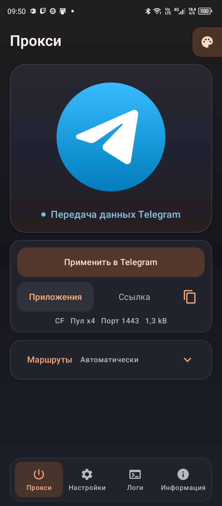
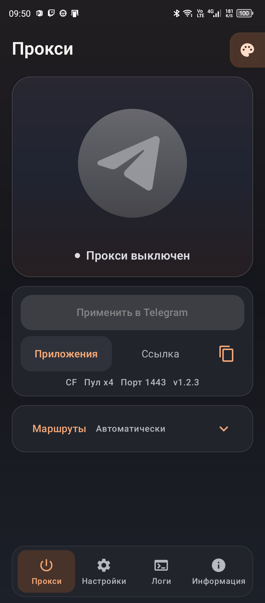

<h1 align="center">TGWS Rust Proxy</h1>

<p align="center">
  Локальный MTProto-прокси для Telegram на Android<br>
  Rust · Kotlin · Jetpack Compose
</p>

TGWS Rust запускает прокси на устройстве и помогает подключить к нему Telegram. Приложение объединяет сетевой движок на Rust с интерфейсом на Jetpack Compose.

<p align="center">
  
  
</p>

Снимки показывают интерфейс во время разработки. Внешний вид и возможности могут измениться до выпуска.

## Возможности

- Запуск и остановка локального прокси, настройка подключения в Telegram.
- Автоматический выбор маршрутов и сведения о состоянии соединений.
- Настройка локального адреса, порта и пула WebSocket.
- Уведомление с временем работы и объёмом переданных данных.
- Светлое и тёмное оформление, цветовые палитры и выбор значка приложения.
- Интерфейс на русском и английском языках.

## Начало работы

Проект находится в разработке. Готовые установочные файлы появятся после подготовки выпуска.

1. Запустите приложение и включите прокси нажатием на центральный знак.
2. Нажмите «Применить в Telegram» и подтвердите настройку в Telegram.
3. При необходимости откройте раздел «Маршруты», чтобы посмотреть состояние подключений.

## Сборка исходников

Проверенная среда включает JDK 17, Rust 1.100.0, Android SDK 35, Android NDK 27.2.12479018 и Gradle Wrapper. Настройте Android SDK через `ANDROID_HOME` или `sdk.dir` в локальном `local.properties`, установите соответствующие Android-цели Rust и сделайте доступными инструменты компиляции Windows.

В Windows выполните:

```bat
build_so.bat --arm64-only
gradlew.bat :app:assembleArm64Debug
```

Команда создаёт отладочный APK для ARM64. Для сборки обеих ARM-архитектур запустите `build_so.bat` без параметров. Release-сборка требует настроек приложения и ключа подписи владельца.

## Авторы и лицензия

TGWS Rust развивается на основе [Android-версии amurcanov](https://github.com/amurcanov/tg-ws-proxy-android) и [TG WS Proxy от Flowseal](https://github.com/Flowseal/tg-ws-proxy).

Проект распространяется на условиях [GPL-3.0](LICENSE). Уведомление о лицензии исходного проекта находится в [LICENSE-Flowseal](LICENSE-Flowseal). Сведения о данных приложения приведены в [политике приватности](PRIVACY.md).
