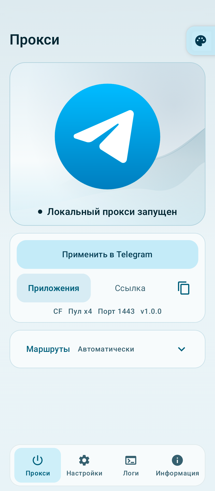
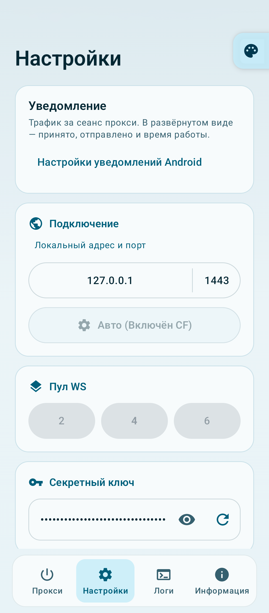
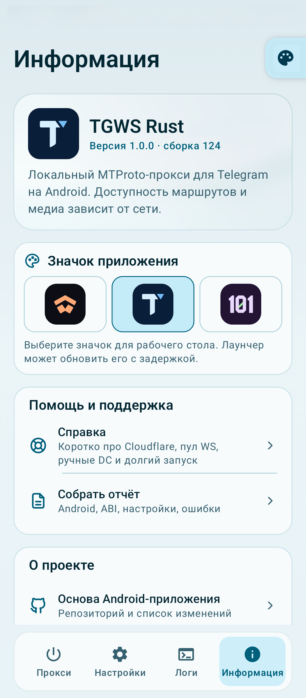

# TGWS Rust Proxy

Локальный MTProto-прокси для Telegram на Android. Приложение работает на телефоне: интерфейс написан на Kotlin и Jetpack Compose, а передача данных выполняется сетевым движком на Rust через WebSocket.

<p align="center">
  
  
  
</p>

[Скачать v1.0.0](https://github.com/wendercurent/TGWS-Rust-Proxy/releases/tag/v1.0.0) · [Сообщить о проблеме](https://github.com/wendercurent/TGWS-Rust-Proxy/issues)

## Что умеет приложение

- Поднимает локальный MTProto-прокси. Обычный адрес — `127.0.0.1:1443`.
- Кнопка **«Применить в Telegram»** передаёт настройку в совместимый клиент. Ссылку можно скопировать отдельно.
- Выбирает маршрут по ответам в текущей сети: прямое защищённое соединение с дата-центром Telegram или резерв через Cloudflare. Ручной порядок маршрутов сохраняется.
- Держит прокси в фоновой службе и показывает уведомление. После краткого разрыва сети служба продолжает слушать локальный порт.
- Показывает понятный статус: не подключено, подключение, подключено, восстановление соединения, нет доступа к сети или не удалось подключиться.
- Даёт русский и английский интерфейс, светлую и тёмную тему и выбор значка.
- В режиме разработчика показывает журнал, состояние маршрута и позволяет скопировать отчёт. Секреты, токены, ссылки прокси, адреса почты и IP-адреса в отчёте скрываются.

Защищённое соединение использует порт 443 и проверяет сертификат и имя сервера. Отдельный режим Cloudflare через порт 80 выключен, пока пользователь сам его не разрешит, и предлагается только для мобильной сети.

## Какая версия Android нужна

Android 5.0 и новее. Есть сборки для 64-битных ARM-устройств, для старых 32-битных ARM-устройств и универсальная сборка с обеими архитектурами.

## Какой файл скачать

| Файл | Кому подходит |
| --- | --- |
| `proxy-universal-release.apk` | Большинству пользователей: один файл для ARM64 и ARM32 |
| `proxy-arm64-v8a-release.apk` | Современным 64-битным телефонам, если нужна сборка только под ARM64 |
| `proxy-armeabi-v7a-release.apk` | Старым 32-битным ARM-телефонам |

Все три файла версии 1.0.0 имеют одинаковый номер сборки, поэтому один вариант можно заменить другим без ошибки понижения версии. Контрольные суммы SHA-256 лежат рядом с файлами в [релизе](https://github.com/wendercurent/TGWS-Rust-Proxy/releases/tag/v1.0.0).

## Как установить и подключить

1. Откройте [страницу релиза](https://github.com/wendercurent/TGWS-Rust-Proxy/releases/tag/v1.0.0) и скачайте подходящий APK.
2. Разрешите установку из этого источника, если Android попросит, и установите приложение.
3. Откройте **TGWS Rust** и включите прокси на главном экране.
4. Нажмите **«Применить в Telegram»** и подтвердите подключение в Telegram.
5. Чтобы выключить прокси, нажмите ту же кнопку ещё раз. Остановить его можно и из уведомления.

Если Telegram не подключается, посмотрите статус на главном экране. Подробный журнал открывается в настройках после включения режима разработчика.

## Ограничения

- Сборка ARM64 версии 1.0.0 проверена на физическом смартфоне с Android 13: установка, запуск, фоновая служба, краткий разрыв Wi-Fi и остановка прокси.
- Сборки ARM32 и Universal отдельно на 32-битном телефоне и на Android 5.0–6.0 не проверялись.
- Обмен сообщениями и загрузка медиа через пакет `dev.wendercurent.tgws` на этом релизе отдельно не подтверждались.
- Звонки Telegram этим прокси не обещаются.

## Сборка из исходников

Для сборки нужны JDK 17, Rust, Android SDK 35 и NDK `27.2.12479018`. Каталог SDK указывается в `ANDROID_HOME` или в локальном файле `local.properties`. Этот файл и ключ подписи в репозиторий не входят.

```bat
build_so.bat
gradlew.bat :app:assembleArm64Debug
```

Публичная сборка использует данные из `branding.properties` и отдельный ключ владельца. Готовые APK этого релиза уже подписаны и лежат в разделе Releases.

## Авторы и лицензии

TGWS Rust Proxy — независимо сопровождаемый форк.

- Оригинальный прокси: [Flowseal/tg-ws-proxy](https://github.com/Flowseal/tg-ws-proxy). Уведомление MIT сохранено в [LICENSE-Flowseal](LICENSE-Flowseal).
- Android-приложение и реализация на Rust, от которых начат этот форк: [amurcanov/tg-ws-proxy-android](https://github.com/amurcanov/tg-ws-proxy-android).

Код этого репозитория распространяется под [GPL-3.0](LICENSE). Краткие сведения о данных приложения — в [политике приватности](PRIVACY.md).
